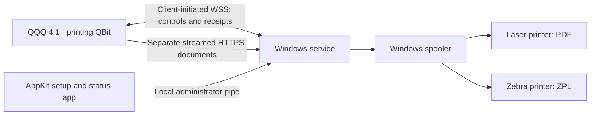

# QQQ Print Agent

<!-- Sized product icon; Markdown has no portable image-sizing syntax. -->
<!-- markdownlint-disable-next-line MD033 -->


[](https://github.com/QRun-IO/qqq-print-agent/actions/workflows/ci.yml)
[](LICENSE)

Print from **QQQ 4.1+** to printers at a local facility without opening inbound network ports. QQQ Print Agent runs as a Windows service, connects outward to QQQ, and submits documents to the printers installed for its Windows service account.

The native setup and status application uses the same [KofTwentyTwo AppKit](https://github.com/KofTwentyTwo/AppKit) foundation as GCLO and MarkdownViewr.Windows.

> **Current source: 0.3.0-rc.1 — unreleased.** It adds a persistent outbound WebSocket, streamed documents and the expanded Jobs view. Source checks do not establish installed or physical-output acceptance. The published baseline is [v0.2.0-rc.1](https://github.com/QRun-IO/qqq-print-agent/releases/tag/v0.2.0-rc.1): its four release assets, checksums and exact-tag attestations are verified, and its tagged build passed 365 tests with zero warnings/errors/skips. The MSI remains unsigned. See [acceptance notes](docs/ACCEPTANCE.md) for version-specific evidence.

The unreleased client requires discovered printing extension `>=2.0.0 <3.0.0` and standard QQQ sign-in. Upgrade the server before adopting it; a 1.0 server cannot provide realtime printing. The service opens authenticated WSS for controls, receipts, status and job notifications, while documents stream separately over HTTPS. There is no job/control polling or fallback. Existing unbound pairings require explicit account association, not automatic replacement. See [realtime operation](docs/REALTIME.md) and [sign-in and migration](docs/QQQ-SIGN-IN.md). Configured Authentik/provider renewal and installed browser-callback acceptance remain separate qualification work.

## Current source features

- Discover Windows print queues and explicitly choose which ones to expose to QQQ.
- Use native Printers, Jobs, Logs and Settings navigation, persistent status, reconnect and a visible health tray icon.
- Browse compact printer/job tables with full details and confirmed test/reprint/cancel actions. Expand a selected row for printer information or recent job history; double-click for printer settings or full job details.
- Sort table headers in either direction. Printers default to Name ascending; jobs default to immutable Created time descending. Job sorting applies across the matching result set before paging.
- Page through local history in groups of 50, searching by job ID, document-title or printer-name prefix.
- Edit computer/printer names, descriptions and locations locally and synchronize them to QQQ.
- Configure daily log retention/size limits, inspect usage and explicitly clear diagnostic logs.
- Start/restart the service and opt into tray startup at sign-in; service and companion share the AppKit log viewer.
- Check for updates manually or at startup using AppKit; confirm a machine MSI upgrade of the service, companion and CLI together.
- Set theme and splash duration, and open project/help/release links and dependency credits.
- Print packing slips and other PDFs through the installed Windows driver.
- Send printer-ready ZPL to Zebra/ZDesigner queues.
- Generate one QQQ-branded warehouse diagnostic at a time: Letter, A4 or 4 × 6-inch PDF; 4 × 6-inch ZPL at 203, 300 or 600 dpi. Native choices prefer ZPL on compatible label queues, with a driver-name DPI suggestion that the operator verifies.
- Sign in using the QQQ server's advertised authentication, then associate an existing pairing or enroll a new device with a short-lived code; the service protects its session and secondary device credential.
- Keep printing when the desktop app is closed or the user logs out.
- Preserve job receipts and outgoing status events across service restarts.
- Avoid automatically printing a job again when a previous submission is uncertain.



The companion projects are [qbit-printing](https://github.com/QRun-IO/qbit-printing), the QQQ server integration, and [qqq-print-protocol](https://github.com/QRun-IO/qqq-print-protocol), the shared versioned API contract. The agent does not require a separate cloud printing vendor.

## Install and connect

1. Download the x64 MSI and `SHA256SUMS` from [Releases](https://github.com/QRun-IO/qqq-print-agent/releases). Verify the checksum before installing.
2. Install the MSI with administrator rights. It installs the service and adds **QQQ Print Agent**, or your configured customer label, under **Print Connectors** in the Start menu.
3. Open **QQQ Print Agent**, accept the administrator prompt and use **Settings → Sign in / Connection settings** to discover the QQQ server's sign-in options and authenticate.
4. For a new pairing, create an enrollment code in QQQ and enter it after sign-in. For an existing unbound pairing, explicitly associate it with your account; do not create a replacement merely to upgrade.
5. In **Printers**, select which queues to expose to QQQ. Then enable the intended discovered queue in QQQ and submit an authorized test document.

The QQQ URL must use HTTPS, with outbound WebSocket upgrades allowed to the same origin. HTTP/WS is accepted only for explicit loopback development. No inbound firewall rule is installed. Existing outbound proxy/network policies and local printer connectivity still apply. The published 0.2 installer retains its earlier HTTP transport; the realtime source above has not been published as an installer.

See the [installation guide](docs/INSTALLATION.md) for verification, service identity, upgrade and removal instructions, and the [user guide](docs/USER-GUIDE.md) for the setup screen and job statuses.

## Requirements and supported behavior

| Area | Unreleased source behavior |
| --- | --- |
| Server | QQQ 4.1+ with printing semantic extension 2.0 and wire-v1 payloads |
| Windows | x64; Windows 11 used for hardware acceptance; API target Windows 10 build 19041+ |
| Runtime | Bundled with the MSI; users do not install .NET separately |
| Printers | Installed Windows queues accessible to LocalSystem, the default service account |
| Documents | PDF and ZPL; administrator defaults are 100 MiB PDF and 20 MiB ZPL, with validated configurable limits |
| PDF options | Copies, actual size or fit; queue-default paper/tray settings |
| ZPL options | Copies; label dimensions/DPI encoded in printer-ready ZPL |
| Transport | Persistent outbound authenticated WSS plus separate same-origin HTTPS streams; no polling fallback |
| Capacity | Configurable bounded download/print lanes, staging, bandwidth and timeouts; one download/print lane by default and ordered submission per printer |

A printer visible only in a signed-in user's profile may not be available to the service. Configure the printer for the machine and test through the installed service. Virtual PDF/fax queues are not suitable for unattended physical printing.

`SPOOLED` means Windows accepted the job. It does **not** prove that paper came out. If the agent cannot determine whether a previous submission succeeded, it reports `OUTCOME_UNKNOWN`; an operator should inspect the printer before requesting another copy.

## Validation so far

The realtime contract and Jobs UI are unreleased. Focused application/UI-test builds passed with zero warnings/errors; three headless request-generation tests passed. They do not execute the desktop assertions or qualify installed realtime behavior. Full consumer, slow-transfer/control, reconnect/replay and installed acceptance are tracked separately in [session state](docs/SESSION-STATE.md).

### Installed published 0.2.0 — 2026-10-31

The exact published 0.2.0-rc.1 MSI installed successfully with pairing, printer exposure and history retained. Native QQQ table-based sign-in, existing-device association, server controls and inventory refresh succeeded. The user confirmed that the Letter PDF and 4 × 6-inch Zebra ZPL printed correctly, and manually confirmed the app's Connected footer and both printers. This is local 0.2 acceptance, not installed or physical-output evidence for unreleased 0.3, Authentik or a remote production deployment. See [acceptance notes](docs/ACCEPTANCE.md).

### Historical 0.1.9 build and installed checks

The 0.1.9 source gate passed **255 tests (66 Core + 189 Windows/CLI)** with zero warnings/errors, and the full solution/UI build passed. [CI build 41185716708](https://github.com/QRun-IO/qqq-print-agent/actions/runs/41185716708) and the required security, CodeQL and script gates passed. The CI MSI upgraded the installed service, companion and CLI with exit 0 and no reboot, preserving protected credentials and journal history. Authenticated management, connection and history checks succeeded; all **16 installed UI checks passed in one run**. No print was submitted by the upgrade or UI tests.

[Release workflow 41190815995](https://github.com/QRun-IO/qqq-print-agent/actions/runs/41190815995) published v0.1.9-rc.1 from protected main revision `cf0e362`. The MSI, `SHA256SUMS`, `Install-Branded.ps1` and `branding.example.json` were verified, including provenance attestations for all four assets. The published MSI differs from the installed CI MSI; runtime sources are unchanged, but the release package has not been separately reinstalled. Their full hashes and verification scopes are in [acceptance notes](docs/ACCEPTANCE.md).

These results cover the local installed service/app upgrade. They do not establish remote deployment, Windows reboot/recovery, updater-initiated elevation, hostile-tree rollback, broad driver qualification or every accessibility scenario. Build attestations establish provenance, not publisher signing; the MSI remains unsigned. The earlier clean service stop still lacks a confirmed cause.

### Historical 0.1.7 hardware acceptance — 2026-10-30

The user confirmed laser PDF, Zebra ZPL and Zebra PDF output on 0.1.7. The first Zebra PDF was accepted by the spooler but did not print until machine defaults were corrected to 4 × 6-inch direct thermal and the hardware pause was cleared. A fresh reviewed PDF then printed fully and correctly. Barcode scanning and measured alignment remain unverified. This dated evidence does not claim fresh physical output from 0.1.9; the [configuration diagnosis and earlier results](docs/ACCEPTANCE.md) retain their original scope.

## Development

Requires Windows x64 and the .NET 10 SDK selected by `global.json`. Check out this repository and the protocol repository as siblings; use the pinned protocol commit in `.github/workflows/ci.yml`.

```powershell
git clone https://github.com/QRun-IO/qqq-print-agent.git
git clone https://github.com/QRun-IO/qqq-print-protocol.git
Set-Location qqq-print-agent
./build/Verify.ps1
./build/Build-Installer.ps1 -ProductVersion 0.3.0 -ReleaseVersion 0.3.0-rc.1
```

[Realtime architecture and settings](docs/REALTIME.md) · [History and log limits](docs/SCALABILITY.md) · [Customer branding](docs/BRANDING.md) · [Developer guide](docs/DEVELOPMENT.md) · [Administrator guide](docs/ADMINISTRATION.md) · [Troubleshooting](docs/TROUBLESHOOTING.md) · [Release process](docs/RELEASING.md) · [Contributing](CONTRIBUTING.md) · [Security policy](SECURITY.md)

## Current limits

Realtime transport requires a matching server and network path that permits WSS; unsupported servers and failed connections do not enable polling. Custom PDF paper dimensions are rejected; use the Windows queue's default media. Physical completion telemetry, custom media and production signing remain outside the deployment scope. Update checks are implemented; installation requires operator confirmation and administrator rights. Configurable limits are resource bounds, not printer-throughput guarantees. Review the [roadmap](docs/TODO.md) before a production rollout.

## License and acknowledgments

[MIT](LICENSE). The original Windows template and AppKit copyright notices are preserved. See [NOTICE](NOTICE) for the foundation and bundled dependency acknowledgments. QQQ and the printing QBit are separate projects with their own licenses.
