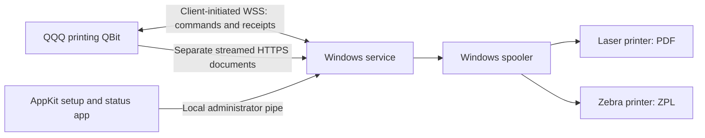

# QQQ Print Agent

<!-- Sized product icon; Markdown has no portable image-sizing syntax. -->
<!-- markdownlint-disable-next-line MD033 -->


[](LICENSE)

Print from **QQQ 4.1+** to local Windows printers without opening inbound network ports. The Windows service opens an authenticated two-way WebSocket to QQQ for commands, status and job notifications. Documents download separately over HTTPS, so a large transfer does not block the control connection. There is no job/control polling fallback.

**Current stable release: [1.2.1](https://git.kof22.com/QRun-IO/qqq-print-agent/releases/tag/v1.2.1)** (generic and GG Forge edition installers). The service, companion, CLI and MSI are signed with Azure Artifact Signing. The matching server release is [qbit-printing 1.1.0](https://git.kof22.com/QRun-IO/qbit-printing/releases/tag/v1.1.0), using QQQ **4.1.0-RC.21** for native session login, with [protocol 1.1.0](https://git.kof22.com/QRun-IO/qqq-print-protocol/releases/tag/v1.1.0); 1.2.1 also works unchanged against qbit-printing 1.0.0. Product versions are separate from native printing API **2.4** (2.3 compatible), wire payload **v1** and WebSocket subprotocol `qqq-printing.v1`.

The setup/status application uses the same [KofTwentyTwo AppKit](https://git.kof22.com/KofTwentyTwo/AppKit) foundation as GCLO and MarkdownViewr.Windows. QQQ's mascot Query appears in About and branded warehouse test documents.

## Install and connect

1. Download `QqqPrintAgent-v1.2.1-x64.msi` (or a client edition such as `GgForgePrintAgent-v1.2.1-x64.msi`; one edition per PC) and `SHA256SUMS` from the [stable release](https://git.kof22.com/QRun-IO/qqq-print-agent/releases/tag/v1.2.1). Check the checksum and Authenticode signature as described in [Installation](docs/INSTALLATION.md).
2. Install with administrator rights. The MSI installs the automatic Windows service and adds **QQQ Print Agent** under **Print Connectors** in Start.
3. Open the app and accept its administrator prompt. Choose **Settings → Server connection → Sign in / Connection settings**, enter the QQQ HTTPS server address and select **Discover sign-in options**. Sign in using the advertised username/password or browser flow.
4. For a new device, create an enrollment code in QQQ under **Printing → Print devices → Actions → Enroll a print device**, then enter it in the client. Existing pairings are reused or explicitly associated with the signed-in account; routine upgrades do not need a replacement pairing.
5. In **Printers**, choose which queues to share. Enable the intended discovered queue in QQQ, then submit an authorized test print matched to the loaded paper or labels.

The service uses machine-installed printers available to its LocalSystem account. A printer mapped only in a user's profile may be unavailable. The QQQ endpoint needs outbound HTTPS and WebSocket upgrades; HTTP/WS is accepted only for loopback development. No inbound firewall rule is installed.

See [User guide](docs/USER-GUIDE.md), [QQQ sign-in](docs/QQQ-SIGN-IN.md) and [Troubleshooting](docs/TROUBLESHOOTING.md).

## Daily use

- **Printers:** share queues, sort columns, expand a selected row, or double-click to edit its name, description and location. The same metadata is reported to QQQ.
- **Jobs:** sort and search paged history, expand a selected row for recent events, or double-click for full details. Printers default to Name ascending; jobs default to Created descending. Reprint and cancellation actions require confirmation.
- **Logs:** service and companion events share the AppKit viewer, with live follow, error filtering, copying and folder access. Settings controls daily rotation, retention, size limits and clearing diagnostic logs.
- **Settings:** select the server and sign in, edit computer details, control the Windows service, choose theme and startup preferences, or check for updates.
- **Footer and tray:** show connection/printer health. The footer exposes the server address, reconnect/log shortcuts and live application upload/download counters. Printer status is an observation from Windows, not proof of paper output.
- **Background printing:** the Windows service keeps working when the companion is closed or the user logs out. Optional tray startup is a separate setting.

QQQ can see devices, exposed printers, status, jobs and queue history. Its authorized device actions control dispatch, disconnect/reconnect operation, refresh inventory and revoke credentials. Current QQQ user, tenant, table, process and record permissions apply to client operations; a device token does not replace user authority.



## Documents and printer media

The service prints PDFs through the Windows driver and sends printer-ready ZPL to compatible Zebra/ZDesigner queues. Test prints offer Letter and A4 PDF, plus 4 × 6, 4 × 2 and 4 × 1-inch PDF/ZPL labels; ZPL offers 203, 300 and 600 dpi. Match the actual stock and printer resolution before printing. Query branding, warehouse-readable characters and alignment marks make the diagnostics easy to identify.

The client reports the Windows queue's machine-default media as a revision-bound profile. It does not detect which stock is physically loaded. Selected media is checked before submission; a stale selection is refused. PDF jobs can instead request an explicit width/height pair for that job without changing the queue defaults. The short-label PDF tests use this path. See [Printer media](docs/PRINTER-MEDIA.md).

`SPOOLED` means Windows accepted the job; it does not prove that paper came out. `OUTCOME_UNKNOWN` means a submission may have reached the printer. Inspect the output before requesting another copy. Retained receipts prevent uncertain jobs from being silently printed again.

## Requirements and limits

| Area | Stable 1.2.1 behavior |
| --- | --- |
| Server | QQQ 4.1+; recommended cohort QQQ 4.1.0-RC.21 and qbit-printing 1.0.0, native printing API 2.3 |
| Windows | x64; Windows 11 used for hardware acceptance; API target Windows 10 build 19041+ |
| Runtime | Bundled with the MSI; users do not install .NET separately |
| Printers | Installed Windows queues accessible to the service account |
| Documents | PDF and ZPL; default limits 100 MiB PDF and 20 MiB ZPL, configurable by authorized QQQ administrators |
| Transport | Outbound authenticated WSS plus same-origin HTTPS document streams, with automatic reconnect |
| Capacity | Bounded download/print concurrency, staging, bandwidth and timeouts; one download and one print lane by default, ordered per printer |
| Local history | 50-row pages; default detailed retention 30 days or latest 300,000 detailed jobs, with active/uncertain evidence and duplicate-suppression records retained |
| Diagnostic logs | Daily rotation plus size rollover to numbered segments; defaults 30 days, 100 MiB per file and 10 segments per day, with optional debug logging, configurable in the client |

The client supports native printing extension `>=2.0.0 <3.0.0`; optional media negotiation requires stable extension 2.3 or later in that major. Limits are resource bounds, not a printer-throughput guarantee. See [Realtime settings](docs/REALTIME.md) and [History and log limits](docs/SCALABILITY.md).

## Updates and customer branding

Use **Help → Check for updates** or the same button in Settings. Startup checks are optional; installation requires confirmation and updates the service, companion and CLI together. Stable installations receive newer stable releases. The installed updater reads the project's [GitHub release feed](https://github.com/QRun-IO/qqq-print-agent/releases); this feed remains available alongside the primary Gitea releases.

Customers can supply a name, company, support link, colors and local artwork during installation using the shared MSI and `Install-Branded.ps1`. No custom build is needed. Branding preserves the software's signing identity, protocol and update feed. See [Customer branding](docs/BRANDING.md).

## Development and contributions

Source, branches, issues and pull requests are maintained on [Gitea](https://git.kof22.com/QRun-IO/qqq-print-agent). GitHub is the automatic source shadow and the existing authorized signing/update distribution bridge; do not push ordinary source changes there.

Use Windows x64 and the .NET 10 SDK selected by `global.json`. Clone the protocol repository beside the client and check out the fixture commit pinned by CI:

```powershell
git clone https://git.kof22.com/QRun-IO/qqq-print-agent.git
git clone https://git.kof22.com/QRun-IO/qqq-print-protocol.git
git -C qqq-print-protocol checkout 42c0d249f81395f00408ec0f92638dcbbf5deb03
Set-Location qqq-print-agent
./build/Verify.ps1
./build/Build-Installer.ps1
```

Run verification only on a permitted Windows test host; host-specific restrictions remain in force. Local packaging is unsigned unless explicitly signed; stable release signing runs through the protected workflow. Neither command installs the service or sends a physical print.

[Contributing](CONTRIBUTING.md) · [Developer guide](docs/DEVELOPMENT.md) · [Administrator guide](docs/ADMINISTRATION.md) · [Release process](docs/RELEASING.md) · [Security policy](SECURITY.md)

## Release evidence

The signed 1.2.1 release passed its protected build, test, security, CodeQL, script and per-edition signing workflow (run 42223525626); checksums, Authenticode signatures and provenance attestations were verified on the published generic and GG Forge installers, and the GG Forge installer was upgraded in place on the development PC with pairing, session and settings preserved. The earlier signed 1.0.1 release passed its protected build, test, security, CodeQL, script and signing workflow. Published checksums, signatures and provenance were verified. The local 1.0.1 MSI upgrade completed successfully on 2026-11-03 with matching app/service/CLI versions and a running service. Dated hardware and earlier upgrade evidence remains in [Acceptance](docs/ACCEPTANCE.md); current release status is in [Release readiness](docs/RELEASE-READINESS.md). Earlier test results retain their original version and scope.

## License and acknowledgments

[MIT](LICENSE). Original Windows template and AppKit notices are preserved in [NOTICE](NOTICE). QQQ and its printing QBit are separate projects with their own licenses. Microsoft Windows SDK components retain their [separate terms](docs/WINDOWS-SDK-LICENSES.md); the installed app includes their license texts and notices.
