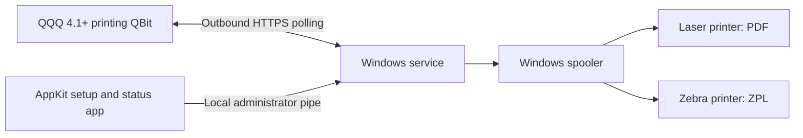

# QQQ Print Agent


[](https://github.com/QRun-IO/qqq-print-agent/actions/workflows/ci.yml)
[](LICENSE)

Print from **QQQ 4.1+** to printers at a local facility without opening inbound network ports. QQQ Print Agent runs as a Windows service, connects outward to QQQ, and submits documents to the printers installed for its Windows service account.

The native setup and status application uses the same [KofTwentyTwo AppKit](https://github.com/KofTwentyTwo/AppKit) foundation as GCLO and MarkdownViewr.Windows.

> **Prerelease software.** Published v0.1.6-rc.1 assets are verified. Installed 0.1.6 passed its 211-test source gate and all 15 UI checks across fourteen plus one runs. The paired local QQQ connection is restored and the service is Running. A Zebra ZT411 at 300 dpi with 4 × 6-inch stock accepted one ZPL shipping test and one PDF barcode/alignment test through the system; physical output and barcode scanning await user confirmation. This used the loopback QQQ server, not a remote cloud deployment. The MSI remains unsigned; the earlier unexplained clean service stop remains under investigation.

## What works

- Discover Windows print queues and explicitly choose which ones to expose to QQQ.
- Use native Printers, Jobs, Logs and Settings navigation, persistent status, reconnect and a visible health tray icon.
- Browse compact printer/job tables with full details and confirmed test/reprint/cancel actions. Version 0.1.6 expands printer information inside the selected row and opens printer settings or job details on double-click.
- Sort table headers in either direction. Printers default to Name ascending; jobs default to immutable Created time descending. Job sorting applies across the matching result set before paging.
- Page through local history in groups of 50, searching by job ID, document-title or printer-name prefix.
- Edit computer/printer names, descriptions and locations locally and synchronize them to QQQ.
- Configure daily log retention/size limits, inspect usage and explicitly clear diagnostic logs.
- Start/restart the service and opt into tray startup at sign-in; service and companion share the AppKit log viewer.
- Check for updates manually or at startup using AppKit; confirm a machine MSI upgrade of the service, companion and CLI together.
- Set theme and splash duration, and open project/help/release links and dependency credits.
- Print packing slips and other PDFs through the installed Windows driver.
- Send printer-ready ZPL to Zebra/ZDesigner queues.
- Enroll once using a short-lived code from QQQ; the service stores its own protected device credential.
- Keep printing when the desktop app is closed or the user logs out.
- Preserve job receipts and outgoing status events across service restarts.
- Avoid automatically printing a job again when a previous submission is uncertain.



The companion projects are [qbit-printing](https://github.com/QRun-IO/qbit-printing), the QQQ server integration, and [qqq-print-protocol](https://github.com/QRun-IO/qqq-print-protocol), the shared versioned API contract. The agent does not require a separate cloud printing vendor.

## Install and connect

1. Download the x64 MSI and `SHA256SUMS` from [Releases](https://github.com/QRun-IO/qqq-print-agent/releases). Verify the checksum before installing.
2. Install the MSI with administrator rights. It installs the service and adds **QQQ Print Agent**, or your configured customer label, under **Print Connectors** in the Start menu.
3. In your QQQ printing administration, create an enrollment code for this facility/device.
4. Open **QQQ Print Agent**, accept the administrator prompt, enter the QQQ server URL and enrollment code, and select **Connect**.
5. In **Printers**, select which queues to expose to QQQ. Then enable the intended discovered queue in QQQ and submit a test document.

The QQQ URL must use HTTPS. HTTP is accepted only for loopback development such as `http://localhost:18081`. No inbound firewall rule is installed. Existing outbound proxy/network policies and local printer connectivity still apply.

See the [installation guide](docs/INSTALLATION.md) for verification, service identity, upgrade and removal instructions, and the [user guide](docs/USER-GUIDE.md) for the setup screen and job statuses.

## Requirements and supported behavior

| Area | Initial support |
| --- | --- |
| Server | QQQ 4.1+ with the printing QBit and protocol v1 |
| Windows | x64; Windows 11 used for hardware acceptance; API target Windows 10 build 19041+ |
| Runtime | Bundled with the MSI; users do not install .NET separately |
| Printers | Installed Windows queues accessible to LocalSystem, the default service account |
| Documents | PDF and ZPL, at most 20 MiB per job |
| PDF options | Copies, actual size or fit; queue-default paper/tray settings |
| ZPL options | Copies; label dimensions/DPI encoded in printer-ready ZPL |
| Transport | Outbound HTTPS polling, normally every five seconds |

A printer visible only in a signed-in user's profile may not be available to the service. Configure the printer for the machine and test through the installed service. Virtual PDF/fax queues are not suitable for unattended physical printing.

`SPOOLED` means Windows accepted the job. It does **not** prove that paper came out. If the agent cannot determine whether a previous submission succeeded, it reports `OUTCOME_UNKNOWN`; an operator should inspect the printer before requesting another copy.

## Validation so far

Installed **0.1.6, source d9033ae**, completed with exit 0 and no reboot, retaining credentials, four printers and two jobs. The source gate passed **211 tests (42 Core + 169 Windows/CLI)** with zero warnings/errors; [exact-source CI 41131558158](https://github.com/QRun-IO/qqq-print-agent/actions/runs/41131558158) succeeded. Management, profile, logs, pagination and branding checks passed. All **15 installed UI checks have passing results across fourteen plus one runs**: the first run passed 14/15, then a test-only arbitrary-text double-click selector was corrected and the focused remaining check passed.

The service was later observed Stopped with exit 0 and no matching crash evidence; the cause remains unknown. A normal UAC-authorized restart succeeded and the final check found it Running, with cloud connectivity offline. No new physical print or separate visual inspection was performed. These results do not establish every Narrator, keyboard, resize, long-text, scaling or high-contrast scenario.

Historically, 0.1.4 passed a zero-warning build and 163 unit/regression tests. Its initial interactive run passed ten of eleven checks, with a log-window discovery timeout; the user separately confirmed that its tray icon worked. Those earlier results do not qualify later changes.

Earlier end-to-end local acceptance used the actual Java QQQ printing server, enrolled Windows connector, and a Canon laser queue. The user confirmed correct physical PDF output. The installed LocalSystem service path and MSI install/uninstall were also exercised; see [acceptance notes](docs/ACCEPTANCE.md).

The Zebra adapter is implemented, but physical Zebra qualification is pending connection of the printer. Automated tests cover the protocol fixtures, content integrity, duplicate suppression, uncertain submission, durable SQLite events and protected credential round trips. Test counts and remaining limits are recorded in the acceptance notes.

## Development

Requires Windows x64 and the .NET 10 SDK selected by `global.json`. Check out this repository and the protocol repository as siblings; use the pinned protocol commit in `.github/workflows/ci.yml`.

```powershell
git clone https://github.com/QRun-IO/qqq-print-agent.git
git clone https://github.com/QRun-IO/qqq-print-protocol.git
Set-Location qqq-print-agent
./build/Verify.ps1
./build/Build-Installer.ps1 -ProductVersion 0.1.4 -ReleaseVersion 0.1.4-rc.1
```

[History and log limits](docs/SCALABILITY.md) · [Customer branding](docs/BRANDING.md) · [Developer guide](docs/DEVELOPMENT.md) · [Administrator guide](docs/ADMINISTRATION.md) · [Troubleshooting](docs/TROUBLESHOOTING.md) · [Release process](docs/RELEASING.md) · [Contributing](CONTRIBUTING.md) · [Security policy](SECURITY.md)

## Current limits

This prerelease uses polling rather than WebSocket notifications. Custom PDF paper dimensions are rejected; use the Windows queue's default media. Operator actions, safe journal detail retention and bounded renderer subprocesses are implemented. Physical completion telemetry, custom media and production signing remain outside the initial deployment scope. Update checks are implemented; installation requires operator confirmation and administrator rights. Review the [roadmap](docs/TODO.md) before a production rollout.

## License and acknowledgments

[MIT](LICENSE). The original Windows template and AppKit copyright notices are preserved. See [NOTICE](NOTICE) for the foundation and bundled dependency acknowledgments. QQQ and the printing QBit are separate projects with their own licenses.
